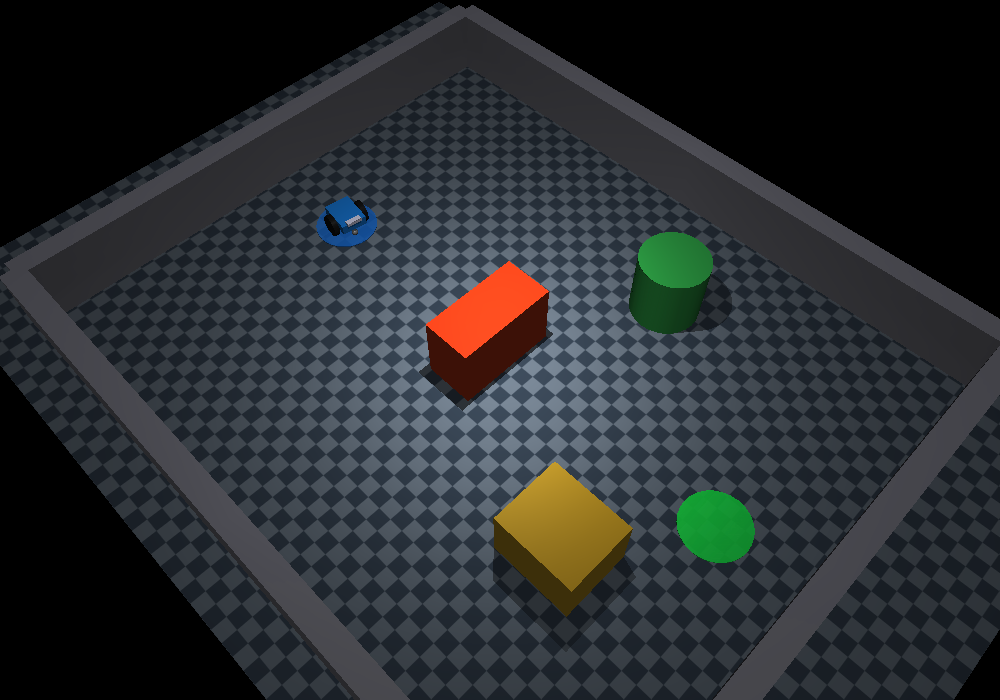
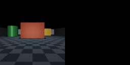

# Event-Based Robot Navigation

Obstacle avoidance in **MuJoCo** using synthetic event-based vision and a custom
**Spiking Neural Network**, with a CNN baseline and optional **ROS 2 Humble** integration.

<p align="center">
  
</p>

```text
MuJoCo camera → v2e events → SNN / CNN → LEFT · STRAIGHT · RIGHT → robot
```

<p align="center">
  
</p>

## Quick start

**Ubuntu 22.04 / WSL2 · Python 3.10 · WSLg for the viewer**

Run these commands from the cloned repository:

```bash
sudo apt update
sudo apt install python3-venv python3-pip python3-tk libgl1
python3 -m pip install --user uv
~/.local/bin/uv sync --locked
bash scripts/setup_ml.sh
.venv/bin/python -m neuroavoid.check_environment

# Autonomous SNN demo
.venv/bin/python -m neuroavoid.run_snn_robot --viewer --output "artifacts/demo_snn_$(date +%s)"
```

Press **X** or close the window to exit. Each run needs a new output directory.
The two small trained models in `models/` are included: no dataset or training is
needed to run the demos. Initial dependency installation requires internet access.

```bash
# CNN baseline
.venv/bin/python -m neuroavoid.run_snn_robot --checkpoint models/cnn.pt --viewer --output "artifacts/demo_cnn_$(date +%s)"

# Manual driving: Z/W forward, Q/A left, D right, S/space stop, R reset
~/.local/bin/uv run --locked drive-robot
```

Two Python environments separate MuJoCo (`.venv`) from PyTorch/v2e (`.venv-v2e`).
On WSL, the viewer uses software rendering to avoid the observed D3D12 black screen.
A complete dependency installation has not been revalidated on a second clean machine.

## ROS 2 (optional)

With **ROS 2 Humble** and **colcon** already installed:

```bash
bash scripts/run_ros.sh build
bash scripts/run_ros.sh demo --viewer --output "artifacts/demo_ros2_$(date +%s)"
```

Two nodes exchange event windows and SNN decisions. Missing or stale commands
stop the motors. Simulation waits for each response: this is a lockstep demo.

## Results

Both models use the same five-bin event windows and imitation-learning data.
The SNN uses custom PyTorch LIF neurons and surrogate gradients.

| Held-out evaluation | SNN | CNN |
|---|---:|---:|
| Classification accuracy (288 windows) | 88.9% | 82.3% |
| Macro-F1 | 0.773 | 0.685 |
| Mean model inference, CPU / batch 1 | 1.94 ms | 0.30 ms |
| Navigation success, normal speed | 0/2 | 1/2 |
| Navigation success, speed ×1.75 | 0/2 | 1/2 |

The SNN classifies recordings better; the CNN is faster and completes more test
routes. Navigation generalization remains limited. The benchmark is small:
two held-out map variants per speed, one start per map. Inference timing excludes
camera capture, event conversion, encoding, transport and the 100 ms observation window.
Events are synthetic; no physical event camera or neuromorphic hardware is used.
No real-time guarantee or energy saving is claimed.

## Repository

- `src/` — simulation, event pipeline, models, training and benchmarks
- `scripts/` — setup, model workers and ROS 2 launch helpers
- `ros_ws/src/` — ROS 2 message definitions
- `models/` — trained SNN/CNN weights and [model cards](models/README.md)
- `third_party/v2e/` — vendored event emulator with its license and provenance
- `tests/` — verification

Datasets, run outputs, reports, Python environments and ROS build files stay local.
The README images are the only included generated previews.

```bash
.venv/bin/python -m unittest discover -s tests -v
PYTHONPATH=src .venv-v2e/bin/python -m unittest discover -s tests -p test_snn.py -v
PYTHONPATH=src .venv-v2e/bin/python -m unittest discover -s tests -p test_cnn.py -v
```

[MIT License](LICENSE) · [Third-party notices](THIRD_PARTY_NOTICES.md)
